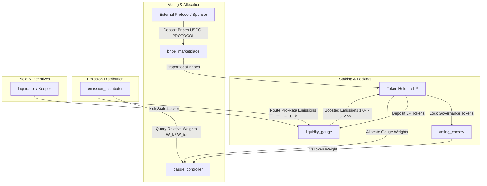

# OrpheusGauge

[](https://github.com/ZengLLQ/orpheus-gauge/actions/workflows/ci.yml)
[](LICENSE)
[](https://aptos.dev)

Production-Grade Vote-Escrowed (veToken) Governance, Multi-Gauge Liquidity Emission Controller, Dynamic Boost Engine & Continuous Multi-Token Bribe Marketplace in Aptos Move.

---

## 1. Executive Summary & Protocol Overview

**OrpheusGauge** is a high-performance decentralized governance and emission orchestration engine designed for the Aptos blockchain. Built on Move's object-centric capabilities and linear resource logic, OrpheusGauge implements a complete Vote-Escrowed (veToken) tokenomics stack with:

1. **Piecewise-Linear Vote-Escrow Lock Decay (`voting_escrow`)**: Users commit governance tokens for durations up to 4 years ($126,144,000\text{ seconds}$). Voting power decays deterministically towards zero at lock expiration, checkpointed via scheduled slope adjustments $\Delta\mu$ at weekly boundaries.
2. **Multi-Gauge Weight Allocation (`gauge_controller`)**: veToken holders allocate up to 10,000 basis points ($100.00\%$) across verified liquidity gauges. Votes take effect across weekly Thursday 00:00:00 UTC epochs with strict cooldown protection against flash-loan vote hijacking.
3. **Continuous Volatility-Adaptive Boost Engine (`liquidity_gauge`)**: Liquidity providers earn emissions scaled between $1.0\times$ (40% unboosted floor) and $2.5\times$ (100% cap) based on their proportional veToken voting weight. A trustless `kick` mechanism prevents stale-boost hoarding when a user's lock expires.
4. **Decaying Epoch Emission Distributor (`emission_distributor`)**: Global emission schedule decaying exponentially by configurable basis points per epoch towards a guaranteed floor, preserving exact wei-level conservation ($\sum E_k = R_{epoch}$).
5. **Continuous Multi-Token Bribe Marketplace (`bribe_marketplace`)**: External protocols deposit arbitrary incentive tokens into epoch-specific bribe pools. Voters claim rewards strictly proportional to their allocated gauge voting weight without double-claim vulnerability or balance drainage.



---

## 2. Mathematical Architecture

### 2.1 Vote-Escrow Linear Decay Model

For a lock of principal $A$ committed until timestamp $T_{end} = \lfloor \frac{t + \Delta t}{WEEK} \rfloor \times WEEK$, the continuous slope $\mu$ and initial bias $\beta$ are defined by:

$$\mu = \frac{A \times 10^{18}}{T_{max}}, \quad \text{where } T_{max} = 126,144,000\text{ s } (4\text{ years})$$

$$\beta(t) = \mu \times \frac{T_{end} - t}{10^{18}}$$

At any evaluation timestamp $t \in [t_0, T_{end}]$:

$$W(t) = \max\left(0,\; \beta(t_0) - \mu \times \frac{t - t_0}{10^{18}}\right)$$

At each weekly boundary $w \in \{w_1, w_2, \dots\}$, scheduled slope decrements are executed in $O(1)$:

$$\mu_{total}(w^+) = \mu_{total}(w^-) - \sum_{i: T_{end, i} = w} \mu_i$$

$$\beta_{total}(w^+) = \beta_{total}(w^-) - \mu_{total}(w^-) \times \frac{WEEK}{10^{18}}$$

### 2.2 Curve/Velodrome Liquidity Boost Dynamics

Let $l_i$ be user $i$'s staked LP balance, $L$ be total pool staked LP, $w_i$ be user $i$'s current veToken power, and $W$ be total active veToken power. The effective boosted balance $l_i^*$ is governed by:

$$l_i^* = \min\left(l_i \times 0.40 + L \times \frac{w_i}{W} \times 0.60,\; l_i\right)$$

$$\text{Boost Factor } B_i = \frac{l_i^*}{l_i \times 0.40} \in [1.0\times, 2.5\times]$$

### 2.3 Master Reward Index Accumulator ($O(1)$)

When emission tranche $\Delta R$ is notified to a liquidity gauge with active boosted liquidity $L^* = \sum l_i^*$:

$$I_{acc}(t) = I_{acc}(t_{last}) + \frac{\Delta R \times 10^{18}}{L^*}$$

For user $i$ interacting with the gauge:

$$\Delta r_i = \frac{l_i^* \times (I_{acc} - I_{user, i})}{10^{18}}$$

$$r_{unclaimed, i} \leftarrow r_{unclaimed, i} + \Delta r_i, \quad I_{user, i} \leftarrow I_{acc}$$

### 2.4 Bribe Pro-Rata Distribution & Bound Protection

For bribe token $j$ deposited in epoch $E$ for gauge $k$ with funded budget $B_{j, k, E}$:

$$r_{bribe, i} = \min\left(\frac{B_{j, k, E} \times w_{i, k}(E)}{W_k(E)},\; B_{j, k, E} - C_{claimed, j, k, E}\right)$$

This condition mathematically guarantees that cumulative claims never exceed funded balances regardless of discrete integer rounding behavior.

---

## 3. Module Hierarchy & Architecture

| Module | Responsibility | Key Structs & Capabilities |
| :--- | :--- | :--- |
| `orpheus_gauge::math` | Fixed-point arithmetic (WAD $10^{18}$, RAY $10^{27}$), weekly epoch rounding, linear decay, Curve boost equations. | Pure mathematical utility functions. |
| `orpheus_gauge::voting_escrow` | Token locking, slope/bias point checkpoints, global schedule table, extension, withdrawal. | `EscrowState`, `Point`, `LockedBalance`, event handles. |
| `orpheus_gauge::gauge_controller` | Gauge registry, vote allocation, slope rollover, relative weight calculation ($f_k = W_k / W_{tot}$). | `ControllerState`, `GaugeInfo`, `UserVote`, event handles. |
| `orpheus_gauge::emission_distributor` | Exponentially decaying emission schedule, epoch synchronization, wei-conserving distribution. | `DistributorState`, `EmissionDistributedEvent`. |
| `orpheus_gauge::liquidity_gauge` | LP staking, boosted balance tracking, $O(1)$ master index reward accumulator, trustless kick. | `GaugePool`, `UserLPPosition`, event handles. |
| `orpheus_gauge::bribe_marketplace` | Multi-token incentive deposits, epoch-gated claims, anti-double-spend claim ledger. | `MarketplaceState`, `BribePool`, event handles. |

---

## 4. Verification & Quality Gates

The protocol is thoroughly verified with an extensive automated test suite covering unit operations, multi-agent game-theoretic incentives, and formal mathematical invariants.

```bash
# Run the full test suite
aptos move test
```

### Test Coverage Summary (24/24 Passing)

```text
Running Move unit tests
[ PASS    ] 0x8f5::math_tests::test_constants_and_scaling
[ PASS    ] 0x8f5::math_tests::test_curve_boost_dynamics
[ PASS    ] 0x8f5::math_tests::test_fixed_point_arithmetic
[ PASS    ] 0x8f5::math_tests::test_slope_and_bias_decay
[ PASS    ] 0x8f5::math_tests::test_week_rounding
[ PASS    ] 0x8f5::invariant_tests::test_boost_boundary_invariants
[ PASS    ] 0x8f5::invariant_tests::test_decay_monotonicity_invariant
[ PASS    ] 0x8f5::voting_escrow_tests::test_duplicate_lock_reverts
[ PASS    ] 0x8f5::liquidity_gauge_tests::test_boosted_staking_and_rewards
[ PASS    ] 0x8f5::gauge_controller_tests::test_gauge_voting_and_relative_weights
[ PASS    ] 0x8f5::emission_distributor_tests::test_double_distribution_in_same_epoch_reverts
[ PASS    ] 0x8f5::bribe_tests::test_bribe_deposit_and_proportional_claim
[ PASS    ] 0x8f5::voting_escrow_tests::test_early_withdraw_reverts
[ PASS    ] 0x8f5::emission_distributor_tests::test_emission_decay_schedule
[ PASS    ] 0x8f5::liquidity_gauge_tests::test_kick_expired_locker
[ PASS    ] 0x8f5::liquidity_gauge_tests::test_withdraw_lp
[ PASS    ] 0x8f5::invariant_tests::test_emission_conservation_invariant
[ PASS    ] 0x8f5::voting_escrow_tests::test_extend_lock_duration
[ PASS    ] 0x8f5::gauge_controller_tests::test_vote_cooldown_reverts
[ PASS    ] 0x8f5::bribe_tests::test_double_claim_reverts
[ PASS    ] 0x8f5::emission_distributor_tests::test_emission_distribution_lifecycle
[ PASS    ] 0x8f5::voting_escrow_tests::test_increase_amount
[ PASS    ] 0x8f5::gauge_controller_tests::test_vote_exceeding_100_percent_reverts
[ PASS    ] 0x8f5::voting_escrow_tests::test_lock_lifecycle_and_decay
Test result: OK. Total tests: 24; passed: 24; failed: 0
```

---

## 5. Getting Started & CLI Usage

### Prerequisites
- [Aptos CLI](https://aptos.dev/tools/aptos-cli/) version 6.0.0 or higher.
- Git.

### Build and Compilation
```bash
git clone https://github.com/ZengLLQ/orpheus-gauge.git
cd orpheus-gauge

# Compile Move bytecode
aptos move compile
```

### Running Tests
```bash
# Execute unit and invariant test suite
aptos move test

# Filter specific module tests
aptos move test -f voting_escrow
aptos move test -f liquidity_gauge
```

---

## 6. End-to-End Workflow Example

```move
// 1. Initialize Protocol
voting_escrow::initialize(admin);
gauge_controller::initialize(admin);
emission_distributor::initialize(admin, 1000000, 100, 100000, current_time);
liquidity_gauge::initialize_gauge(admin, 1, current_time);
bribe_marketplace::initialize(admin);

// 2. Lock Governance Tokens for 4 Years (Max Boost)
voting_escrow::create_lock(alice, escrow_addr, 100000, math::max_lock_time(), current_time);

// 3. Vote 100% of veToken Weight for Gauge 1
let g_ids = vector[1];
let weights = vector[10000]; // 100.00%
gauge_controller::vote_for_gauge_weights(alice, controller_addr, escrow_addr, g_ids, weights, current_time);

// 4. Stake LP Tokens with 2.5x Boost Factor
liquidity_gauge::deposit_lp(alice, gauge_addr, escrow_addr, 10000, current_time);

// 5. Deposit External Bribe Incentives (e.g. 50,000 USDC)
bribe_marketplace::deposit_bribe(sponsor, market_addr, 1, target_epoch, 1, 50000, current_time);

// 6. Distribute Epoch Emissions
let (epoch_budget, g_ids, amounts) = emission_distributor::distribute_epoch_emissions(
    distributor_addr,
    controller_addr,
    current_time
);
liquidity_gauge::notify_emission_reward(gauge_addr, *vector::borrow(&amounts, 0), current_time);

// 7. Claim Accrued Emissions & Bribes
let lp_rewards = liquidity_gauge::claim_rewards(alice, gauge_addr);
let bribe_rewards = bribe_marketplace::claim_bribe(alice, market_addr, controller_addr, 1, target_epoch, 1, target_epoch + 10);
```

---

## 7. Design Trade-Offs & Limitations

1. **Epoch Granularity**: Lock expirations, emission schedules, and bribe distributions are rounded down to weekly intervals (`WEEK = 604,800s`). Intra-week locks expire at the start of the final week, preventing fractional-epoch gaming while bounding state size.
2. **Kick vs Automatic Re-indexing**: In high-throughput AMMs, tracking decayed locks across thousands of passive users continuously would induce prohibitive gas consumption. OrpheusGauge adopts the trustless `kick` pattern: any third party can recalculate a user's stale boosted balance once their veToken lock decays, receiving gas refund or arbitrage incentive.
3. **Single Vote Update per Epoch**: Users cannot alter gauge votes more than once per weekly epoch. This completely neutralizes flash-loan voting attacks and MEV bribes that sandwich epoch boundaries.

---

## 8. License

Licensed under the Apache License, Version 2.0 (the "License"). See [LICENSE](LICENSE) for details.
